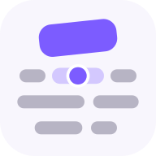
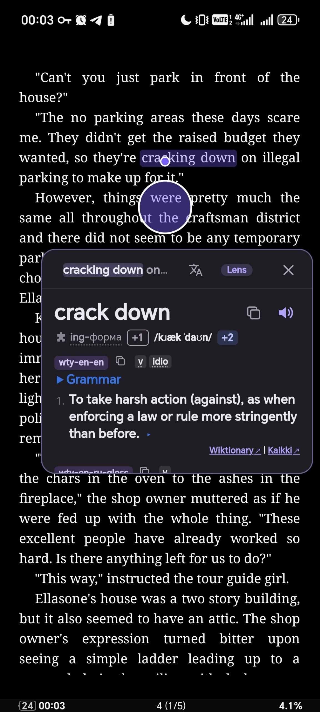
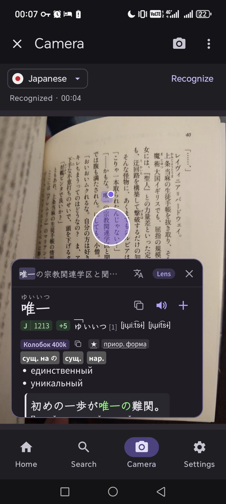
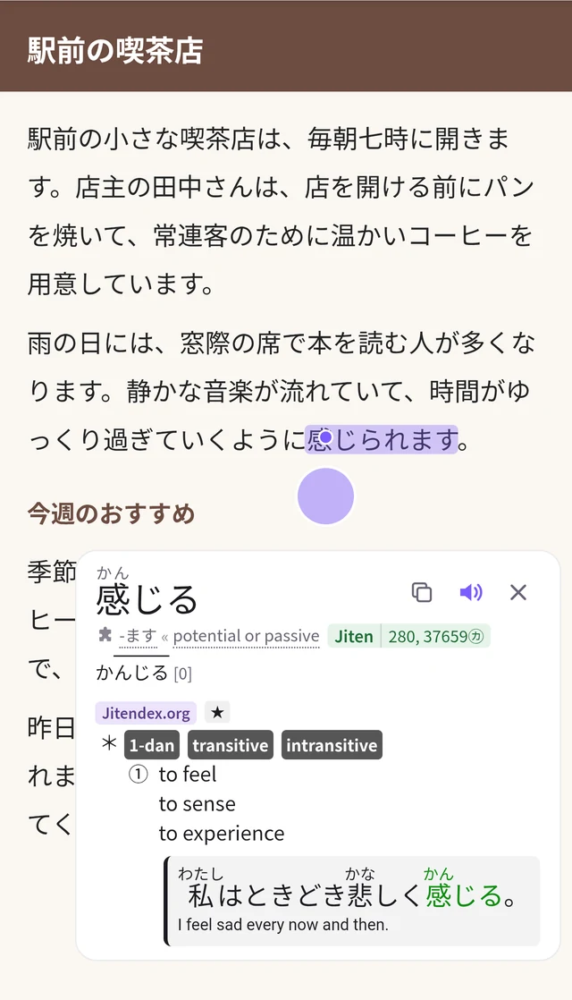
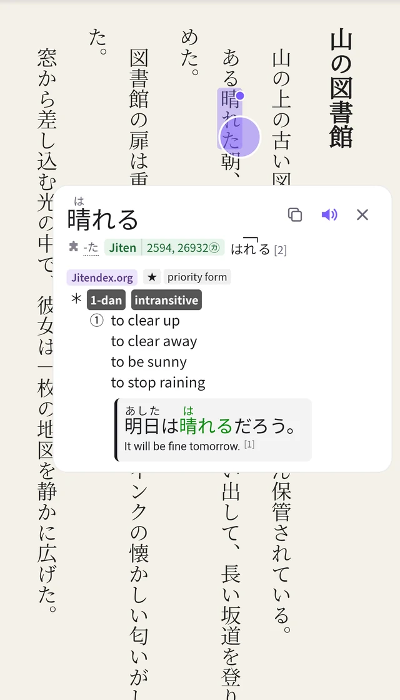
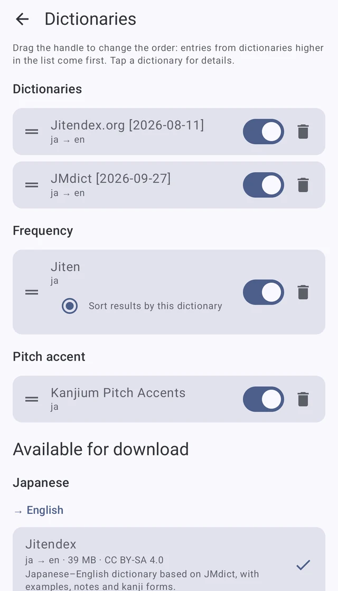
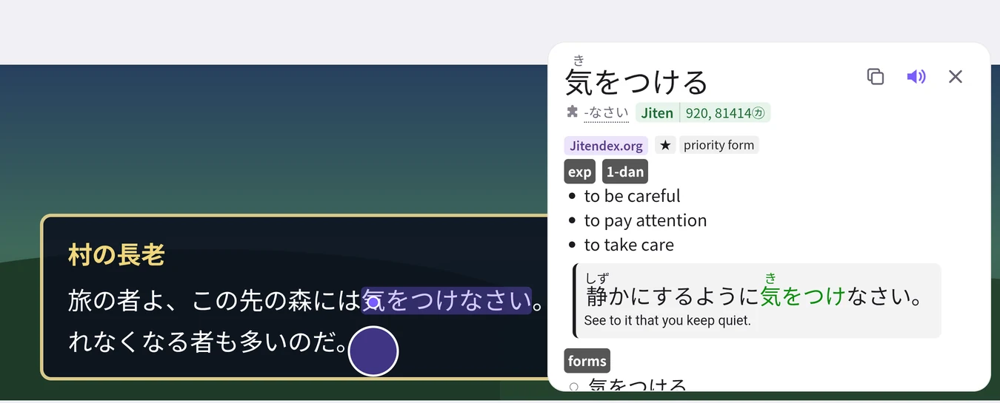

# Screenlate



A pop-up dictionary for Android with lookup in 62 languages. Pull the bubble out from the edge of the screen and point it at a word to look it up in a browser, game, manga reader or paused video. You can also take a photo or open a saved image and look up words directly on it.

<p>
  
  
</p>

<sub>The English lookup uses Wiktionary data via Kaikki. The camera lookup uses the Kolobok 400k dictionary.</sub>

<p>
  
  
  
</p>
<p>
  
</p>

<sub>These Japanese lookup examples use entries from Jitendex (CC BY-SA 4.0), frequencies from Jiten and pitch accents from Kanjium.</sub>

## Features

- **On-screen lookup.** Look up horizontal or vertical text in portrait or landscape. Hold the bubble to copy a paragraph or the full recognized text.
- **Text recognition.** Use cloud recognition, on-device recognition, or both. Choose from the ML Kit, PaddleOCR and Tesseract models available for each language. Screenlate can also use text exposed by the app on screen, including an app-text-only mode for e-ink readers.
- **Camera and images.** Take a photo, pick an image, or share one to Screenlate. Pan and zoom while looking up words on the image, reread small text with high-accuracy recognition, and save images with their recognized text in a private history.
- **Language profiles.** Switch between favorite languages from Home or the bubble's hold menu. Each language has its own dictionaries and lookup, popup, Anki and audio settings.
- **Dictionaries.** Download dictionaries from the built-in catalog, including Japanese dictionaries such as JMdict, Jitendex and KANJIDIC. Choose the languages of definitions and add word forms, frequencies, pronunciation or character dictionaries where available. Import Yomitan `.zip` archives, whole dictionary collections or settings exports.
- **Dictionary entries.** See structured definitions, examples and images, inflections and pronunciation where supported. Look up Chinese by pinyin or Cantonese by Jyutping, tap characters for separate entries, and optionally color Japanese pitch accents or Chinese and Cantonese tones.
- **Search and translation.** Type a word in Search or use “Look up in Screenlate” from another app's text selection menu. The popup can copy definitions and translate the sentence around a word.
- **Pronunciation and Anki.** Play recordings or use the device's text-to-speech. Add cards through AnkiDroid with configurable fields, duplicate checks, audio, a screen capture or a crop from the original photo.
- **Appearance and backups.** Customize the popup font, size, weight and CSS, or use light, dark or e-ink mode. Back up selected language profiles, settings, fonts, dictionaries and recognition models in one file. Check for app updates from About.

## Supported languages

**Dictionary lookup (62 languages)**

- **A–C** Albanian, Arabic, Armenian, Azerbaijani, Belarusian, Bengali, Bulgarian, Cantonese, Chinese (Simplified and Traditional), Croatian, Czech
- **D–H** Danish, Dutch, English, Esperanto, Estonian, Filipino (Tagalog), Finnish, French, Georgian, German, Greek, Hebrew, Hindi, Hungarian
- **I–L** Indonesian, Irish, Italian, Japanese, Kannada, Kazakh, Khmer, Korean, Kyrgyz, Latin, Latvian, Lithuanian
- **M–R** Macedonian, Malay, Marathi, Mongolian, Norwegian (Bokmål and Nynorsk), Persian, Polish, Portuguese, Romanian, Russian
- **S–W** Scottish Gaelic, Serbian, Slovak, Slovenian, Spanish, Swahili, Swedish, Tamil, Telugu, Thai, Turkish, Ukrainian, Uzbek, Vietnamese, Welsh

Available recognition models, definition languages and supplementary dictionaries vary by language.

**Interface (17 languages)**

Arabic, Chinese (Simplified), Chinese (Traditional), English, French, German, Hebrew, Italian, Japanese, Korean, Persian, Polish, Portuguese (Brazil), Russian, Spanish, Turkish and Vietnamese.

Translations of the interface were made with AI and have not been reviewed by native speakers. Corrections are welcome: open an issue or a pull request with the fixed `strings.xml`.

## Install

This README describes the current source tree. See the release notes for the changes available in each APK.

1. Download an APK from [Releases](https://github.com/v1p3rrr/screenlate/releases/latest). Use `arm64-v8a` for most phones, `armeabi-v7a` for older 32-bit devices, `x86_64` for compatible emulators or `universal` for all supported architectures. Obtainium can track the releases too.
2. Open Screenlate and choose a language and dictionaries to download. For bubble lookup, enable the accessibility service from Home. The service draws the bubble and reads the screen when you scan.
3. If the switch is greyed out after installing from a file: App info → ⋮ → Allow restricted settings.
4. On phones with aggressive battery management, let Screenlate run in the background, or the system may stop the service.

[docs/usage.md](docs/usage.md) explains the gestures and every setting.

## Requirements

- Android 11 or newer.
- AnkiDroid, for Anki cards.
- A network connection for cloud recognition, sentence translation, online audio and downloads. Installed dictionaries, on-device recognition where a model is available, and text exposed by apps work offline.

## Limitations

- Cloud recognition uses an unofficial service that may change or stop working. On-device recognition accuracy varies with the model, script and text size.
- Screens that block screenshots (some banking apps, protected video) cannot be scanned. "Read app text" and "App text only" can still read apps that expose their text.
- The bubble runs in an accessibility service; some phones stop such services in the background (see Install). The start screen then reports it and links to the switch; an optional persistent notification reduces how often this happens.
- Developed and tested on a small number of devices.

## Privacy

- No accounts, ads or analytics.
- Cloud recognition sends a screen capture when you scan or image data when you recognize a photo. On-device recognition and text exposed by apps are processed locally.
- Camera history stores photos and their recognized text in Screenlate's private storage. Saving a photo to the gallery makes a separate copy.
- Sentence translation sends the sentence to an online translator when you ask for it in the popup or a note template uses it.
- Audio sources receive the word being played. Dictionary downloads and update checks contact the dictionary hosts and GitHub.
- The accessibility service reads the screen only when you scan. It also notices which app is in front, to hide the bubble in the apps you choose. The app shows this before opening the accessibility settings and under About.
- The app's log never contains recognized text or looked-up words and leaves the phone only when shared by the user.

## License

Screenlate is free software under the GPL-3.0 ([LICENSE](LICENSE)). [NOTICE](NOTICE) lists the third-party code and data with their licenses; the app shows the same under About.

Dictionaries from the catalog are downloaded from their authors' releases and show their license before downloading; imported dictionaries are subject to their own licenses.

Screenlate is an independent project, not affiliated with the dictionary authors, Anki, AnkiDroid, Yomitan or the cloud recognition provider.

## Building from source

```
git submodule update --init --recursive
./gradlew assembleDebug
```

Needs JDK 17+, the Android SDK with platform 37, NDK 29.0.14206865 and CMake 3.31.6. [docs/development.md](docs/development.md) covers tests, releases and signing; [docs/architecture.md](docs/architecture.md) the internals.
