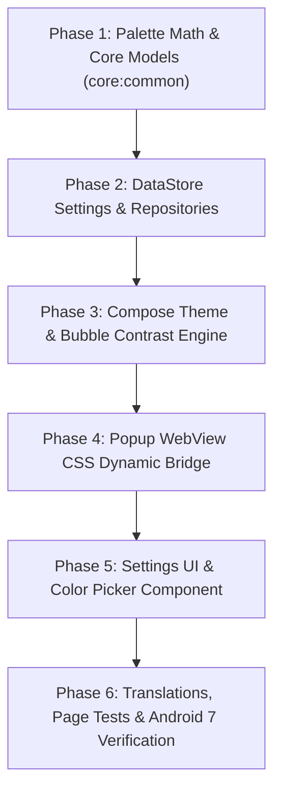

# Color Scheme Customization Plan

**Date:** 2026-11-14  
**Branch:** `features/color-scheme-customization` (branched from `origin/main` at `95d8b88bf`)  
**Target:** Android 7.0 (API 24) to Android 15 (API 35+)

---

## 1. Context & Objectives

Currently, Screenlate uses a hard-coded brand violet palette (`#7C5CFF`) for the floating bubble (`BubbleView`), the Compose app UI (`ScreenlateLight` and `ScreenlateDark` in `Color.kt`), and the dictionary popup (`popup.css` with `--accent: #7c5cff` and `--matched-bg: rgba(124, 92, 255, 0.18)`). On Android 12+, users can choose "System colors" from their wallpaper, but on older Android versions (or for users who want a custom look), no other colors are available.

The goal is to allow users to customize their color scheme across:
1. **App UI (Compose):** Generated light and dark Material 3 color schemes based on a chosen seed color.
2. **Floating Bubble (`BubbleView`):** Primary disc fill dynamically updated, with automatic luminance detection to invert ring, center dot, loading arc, and language glyph when a light color is chosen.
3. **Dictionary Popup (WebView CSS):** Dynamic CSS variable injection (`--accent`, `--matched-bg`, `--chip-bg`, `--border`) so highlighted matches and UI chips harmonize with the chosen theme.

---

## 2. Decision Table

| Question | Options Considered | Decision | Rationale |
|---|---|---|---|
| **Theme Color Picker UI** | A. Presets + Custom Color Picker (Recommended)<br>B. Presets only<br>C. Custom picker only | **A. Presets + Custom Color Picker** | Offers instant, beautiful one-tap options (8 curated palettes) while giving power users freedom to pick any custom HEX/HSV color. |
| **Bubble Color Coupling** | A. Synced by default with override in Bubble Settings (Recommended)<br>B. Strictly unified (no separate bubble setting)<br>C. Completely separate settings | **A. Synced by default with override** | Most users want a unified aesthetic, but users who want high bubble visibility on arbitrary wallpapers can customize the bubble independently. |
| **Accent Color Generation** | A. Harmonious hue shift (~45–60°) (Recommended)<br>B. Monochromatic M3 tonal palette<br>C. Keep pink accent `#FF78CD` always | **A. Harmonious hue shift** | Keeps Screenlate's signature playful, high-contrast look (switches, sliders, buttons pop against the primary color) across any chosen seed color. |
| **Popup WebView Integration** | A. Dynamically inject CSS variables (Recommended)<br>B. Keep popup static violet | **A. Dynamically inject CSS variables** | Search match highlights (`--matched-bg`) and action accents in the dictionary popup seamlessly match the active app and bubble theme. |
| **Android 7+ Compatibility** | A. Pure Kotlin color math (HSL/HCT) (Recommended)<br>B. Rely on API 31+ Monet / DynamicColors | **A. Pure Kotlin color math** | Zero API-level dependencies; runs seamlessly on Android 7.0 (API 24) up to Android 15, as well as desktop JVM unit tests. |
| **E-Ink Mode Priority** | A. E-ink strictly overrides colors (Recommended)<br>B. Color themes apply to e-ink | **A. E-ink strictly overrides** | E-ink screens cannot render color tones cleanly without ghosting; black & white mode remains supreme when enabled. |

---

## 3. Architecture & Data Model

### 3.1 Color Palette Model (`core:common`)

```kotlin
package com.vpr.screenlate.core.common.theme

/** Supported preset palettes with curated seed colors and harmonious accents. */
enum class ColorPreset(val id: String, val seedColor: Int, val accentShift: Float = 55f) {
    VIOLET("violet", 0xFF7C5CFF.toInt(), accentShift = 55f),     // Classic Screenlate violet + pink
    OCEAN("ocean", 0xFF0284C7.toInt(), accentShift = 50f),       // Sky blue + cyan/amber
    EMERALD("emerald", 0xFF059669.toInt(), accentShift = 45f),   // Deep emerald + lime gold
    AMBER("amber", 0xFFD97706.toInt(), accentShift = 60f),       // Golden amber + warm bronze
    CORAL("coral", 0xFFE11D48.toInt(), accentShift = 45f),       // Vivid coral red + peach
    SUNSET("sunset", 0xFFEA580C.toInt(), accentShift = 50f),     // Vibrant orange + magenta
    LAVENDER("lavender", 0xFF8B5CF6.toInt(), accentShift = 45f), // Soft purple + berry
    TEAL("teal", 0xFF0D9488.toInt(), accentShift = 50f);        // Teal + coral
}

/** Configuration of the active color scheme. */
data class AppPaletteConfig(
    val useSystemWallpaper: Boolean = false, // Android 12+ Monet
    val preset: ColorPreset? = ColorPreset.VIOLET,
    val customSeedColor: Int? = null,
) {
    val effectiveSeed: Int
        get() = customSeedColor ?: preset?.seedColor ?: ColorPreset.VIOLET.seedColor
}
```

### 3.2 Pure Kotlin Palette Generator (`core:common`)

A lightweight pure Kotlin utility `PaletteGenerator` without Android framework dependencies:
- Converts RGB to HSL and perceptual luminance:
  $$\text{Luminance} = 0.2126 \cdot R + 0.7152 \cdot G + 0.0722 \cdot B$$
- Generates `ColorScheme` values for Light and Dark modes:
  - **Light:** Primary (seed tone ~45), PrimaryContainer (tone ~90), OnPrimaryContainer (tone ~20), Surface/Background tinted with primary hue, Tertiary (accent from shifted hue).
  - **Dark:** Primary (tone ~80), PrimaryContainer (tone ~30), OnPrimaryContainer (tone ~90), Dark surface tinted with primary hue, Tertiary (accent from shifted hue).
- Generates `Accent`:
  - Fill, OnFill, Line with optimal contrast.
- Detects if Bubble needs light or dark text/glyph:
  $$\text{Luminance} > 0.60 \implies \text{Dark glyph/ring (\#1C1B20)}, \quad \text{Else} \implies \text{White (\#FFFFFF)}$$

### 3.3 DataStore Preferences

**In `AppSettingsRepository`:**
- `APP_COLOR_MODE`: string (`"PRESET"`, `"CUSTOM"`, `"SYSTEM"`)
- `APP_COLOR_PRESET`: string (e.g. `"VIOLET"`)
- `APP_COLOR_CUSTOM`: int (ARGB hex)

**In `OverlaySettingsRepository`:**
- `BUBBLE_COLOR_USE_APP`: boolean (default `true`)
- `BUBBLE_COLOR_CUSTOM`: int (default `0x737C5CFF`)

---

## 4. Implementation Phases



### Phase 1: Palette Math & Core Models (`core:common`)
- Create `com.vpr.screenlate.core.common.theme.ColorMath.kt` with pure Kotlin:
  - RGB ↔ HSL conversion.
  - Luminance & contrast ratio calculation.
  - Tone-based color generation (Tonal Spot simulation).
  - Hue rotation for accent generation.
- Create `ColorPreset.kt` and `PaletteConfig.kt`.
- Unit tests: `PaletteGeneratorTest.kt` verifying tone curves, hue shifts, and contrast safety across all presets and arbitrary hex inputs on JVM.

### Phase 2: DataStore Settings & Repositories
- Update `AppSettingsRepository.kt`:
  - Add flows and cached values for `paletteConfig: Flow<AppPaletteConfig>`.
  - Migration/fallback for existing `AppColors` (`SCREENLATE` -> `ColorPreset.VIOLET`, `SYSTEM` -> `useSystemWallpaper = true`).
- Update `OverlaySettingsRepository.kt`:
  - Add `bubbleUseAppColor: Boolean` (default `true`).
  - Add `bubbleCustomColor: Int` (default `0x7C5CFF`).
- Unit tests in `core:common` and `overlay` verifying storage, defaults, and snapshot backup restoration.

### Phase 3: Compose Theme & Bubble Contrast Engine
- Update `app/src/main/java/com/vpr/screenlate/ui/theme/Theme.kt` and `Color.kt`:
  - `ScreenlateTheme` accepts dynamic `AppPaletteConfig`.
  - When `useSystemWallpaper` is false (or API < 31), dynamically construct `ColorScheme` and `LocalAccent` using `PaletteGenerator`.
  - Preserve `LocalEInk` override: E-ink continues to force `EInkColorScheme` and mono accent.
- Update `BubbleView.kt`:
  - Add `bubbleColor: Int` property.
  - Apply 45% alpha (`0x73`) automatically to RGB input.
  - Dynamically set paint colors for `ring`, `dot`, `arc`, and `glyphPaint`:
    - White if luminance $\le 0.60$.
    - Charcoal (`0xFF1C1B20`) if luminance $> 0.60$.
- Update `OverlayController.kt`:
  - Wire `paletteConfig` and `overlaySettings` to update `bubbleView.bubbleColor`.

### Phase 4: Popup WebView CSS Dynamic Bridge
- Update `PageAppearance.kt` and `PageState.kt`:
  - Pass the active primary color and generated accent hex strings into `PageAppearance` JSON payload.
- Update `overlay/src/main/assets/popup/popup.js` (`setAppearance`):
  - Set CSS custom properties on `document.documentElement.style`:
    - `--accent`: primary brand color.
    - `--matched-bg`: primary brand color with 18% opacity (`rgba(r, g, b, 0.18)`).
    - `--chip-bg`: light/dark container color.
    - `--border`: primary brand color with 55% opacity.
- Verify with `scripts/page-tests`:
  - Run `npm test` to ensure no regressions in popup rendering and state handling.

### Phase 5: Settings UI & Color Picker Component
- Redesign `AppColorsSection.kt` in `app/src/main/java/com/vpr/screenlate/settings/`:
  - Swatch row/grid displaying all 8 `ColorPreset` circular chips with checkmarks.
  - If Android 12+ (API 31+): include "System / Wallpaper" chip.
  - "Custom" chip with a color wheel/palette icon.
  - `ColorPickerDialog`: Compose dialog with interactive Hue/Saturation sliders + HEX input field with live preview.
- Update `BubbleSettingsScreen.kt`:
  - Add "Bubble color" section:
    - Switch: "Use app theme color" (default `true`).
    - When switched off: expand color swatches + custom picker for the bubble.

### Phase 6: Translations, Page Tests & Verification
- Add localized strings across all 14 project locales (`values/`, `values-ru/`, etc.):
  - `settings_colors_title`, `settings_colors_custom`, preset names, `bubble_color_use_app`, etc.
- Run test suites:
  - `./gradlew testDebugUnitTest`
  - `npm --prefix scripts/page-tests test`
- Build verification:
  - `./gradlew assembleDebug`
- Independent review check: Ensure no commit touches Android 7 worktree branches so this branch can be merged cleanly to `main`.

---

## 5. Verification & Acceptance Criteria

1. **Preset Switching:** Selecting any of the 8 presets instantly updates App UI, Floating Bubble, and Popup match highlights without activity recreation flicker.
2. **Custom Color Picker:** Entering any valid hex (e.g. `#FF5722`) generates readable, contrast-compliant Light and Dark themes.
3. **Contrast Inversion in Bubble:** Choosing pastel yellow (`#FDE047`) or light cyan (`#67E8F9`) turns the bubble ring, aim dot, loading arc, and glyph to dark charcoal; choosing navy (`#1E3A8A`) keeps them crisp white.
4. **Independent Bubble Color:** Turning off "Use app theme color" allows setting the bubble to emerald green while the app remains violet.
5. **E-Ink Compatibility:** Toggling E-Ink mode completely overrides any chosen color theme, keeping the UI strictly black and white.
6. **Backward Compatibility:** All code compiles and runs with zero crashes on API 24 (Android 7.0) and API 35 (Android 15).
